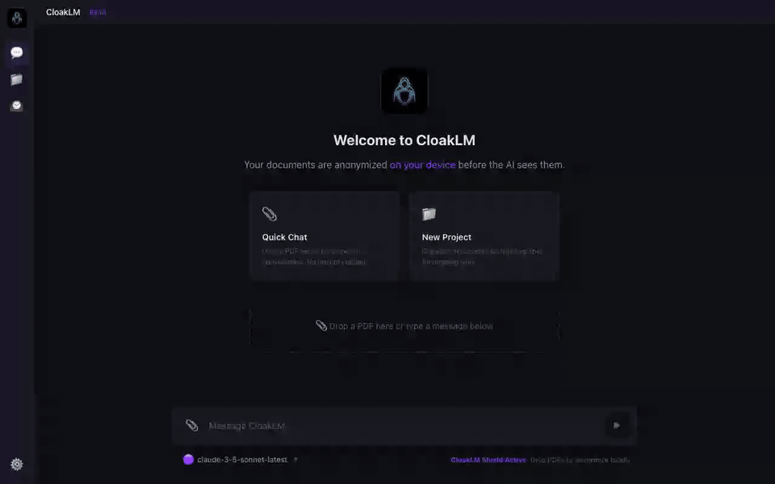
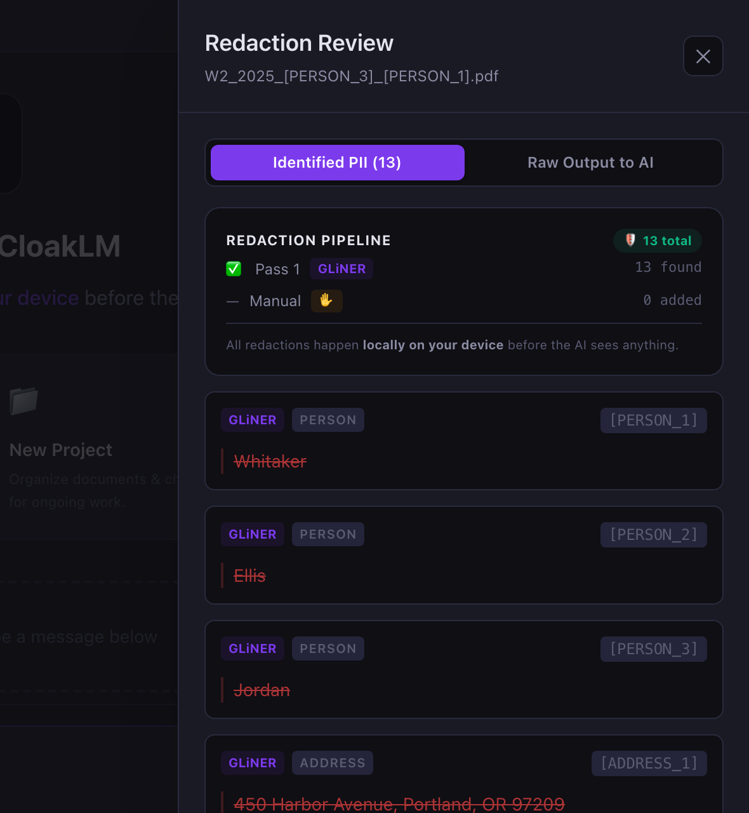
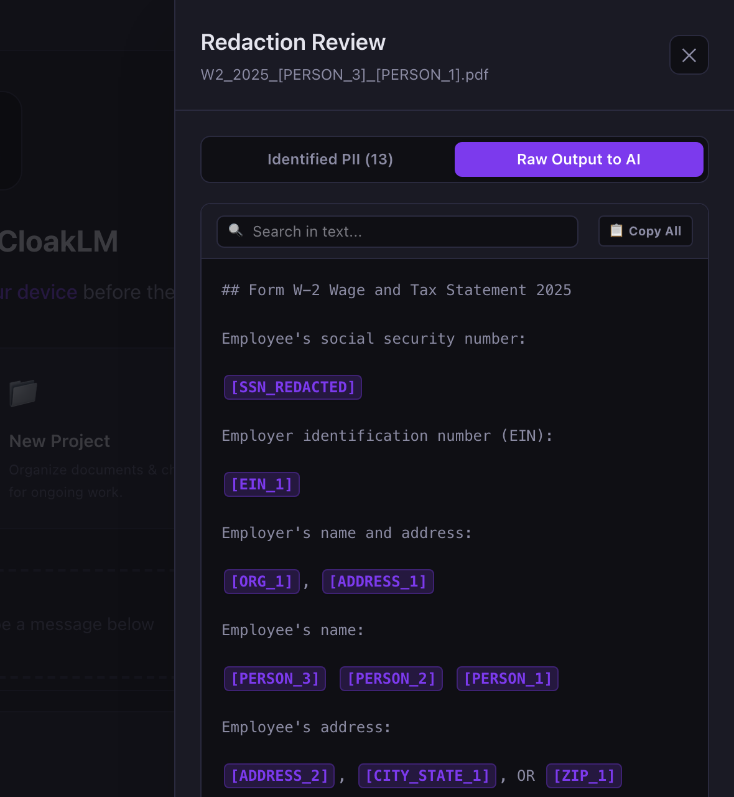

# CloakLM

[](https://github.com/rabahs/cloaklm/releases/latest)
[](./LICENSE)


**Ask AI about your W-2 without giving it your SSN.** Drop in a tax form, bank statement, or medical bill. CloakLM strips the personal information *on your device*, then lets you chat with Claude, GPT, Gemini, or a fully offline Ollama model. The AI sees `[PERSON_1]` and `[SSN_REDACTED]`; you see the real names in its answers.

**[⬇ Download for macOS or Windows](https://github.com/rabahs/cloaklm/releases/latest)** · [Website](https://rabahs.github.io/cloaklm/)



## What the AI actually sees

| You drop in | The AI receives |
|---|---|
| Employee's SSN: 123-45-6789 | Employee's SSN: [SSN_REDACTED] |
| Employer: Brightwater Logistics Inc., 450 Harbor Avenue, Portland, OR 97209 | Employer: [ORG_1], [ADDRESS_1] |
| Employee: Jordan Ellis Whitaker | Employee: [PERSON_3] [PERSON_2] [PERSON_1] |
| Wages: $84,250.00 | Wages: $84,250.00 |

Dollar amounts and document structure stay intact, so the AI can still do the math. Before anything is sent, you can review every redaction and add your own.

<p>
  
  
</p>

## Use cases

- **Tax season**: W-2s, 1099s, prior-year returns, K-1s. Ask "what deductions am I missing?" or "why did my refund drop?"
- **Medical bills & EOBs**: decode insurance statements and spot billing errors
- **Bank & brokerage statements**: categorize spending, summarize fees
- **Leases, contracts, HR documents**: get plain-English explanations without uploading your identity

## How It Works

```
┌─────────────────────────────────────────────────┐
│  1. Drop PDF        2. Local PII Scan           │
│  ───────────►   GLiNER strips names, SSNs, etc. │
│                                                 │
│  3. You Review      4. Chat with AI             │
│  Verify redactions  Claude/Gemini/GPT/Ollama    │
│  Add manual ones    sees [PERSON_1], not "John"  │
│                                                 │
│  5. De-anonymize    You see real names           │
│  AI response shown  AI never did                 │
└─────────────────────────────────────────────────┘
```

## Building from Source

Most people should just [download the app](https://github.com/rabahs/cloaklm/releases/latest). If you'd rather build it yourself:

### Prerequisites
- **Node.js** 22+ (LTS)
- **Rust** 1.84+ (for Tauri)
- **Python** 3.12+

### Setup

```bash
# 1. Install frontend dependencies
npm install

# 2. Create Python virtual environment & install sidecar dependencies
python3 -m venv .venv
source .venv/bin/activate
pip install -r sidecar/requirements.txt

# 3. Start the anonymization engine (Terminal 1)
source .venv/bin/activate
cd sidecar && uvicorn server:app --port 4321

# 4. Start the desktop app (Terminal 2)
npm run tauri dev
```

### Configure API Keys
Click ⚙️ in the app header to add your API keys for:
- **Claude** (Anthropic) — best for nuanced document analysis
- **Gemini** (Google) — fast and cost-effective
- **GPT-4o** (OpenAI) — strong general-purpose
- **Ollama** — 100% offline, no API key needed

## Project Structure

```
cloaklm/
├── src/                    # React + TypeScript + Tailwind CSS frontend
│   ├── App.tsx             # Main app shell
│   ├── llm.ts              # LLM API service (Claude/Gemini/OpenAI/Ollama)
│   ├── types.ts            # Shared TypeScript types
│   └── components/         # UI components
│       ├── ChatHeader.tsx
│       ├── ChatInput.tsx
│       ├── MessageBubble.tsx
│       ├── MessageList.tsx
│       ├── ReviewPanel.tsx
│       ├── SettingsModal.tsx
│       ├── WelcomeScreen.tsx
│       ├── AttachmentChip.tsx
│       └── DropOverlay.tsx
├── src-tauri/              # Rust (Tauri 2.0) desktop wrapper
│   ├── tauri.conf.json     # App config, window settings
│   └── src/
│       ├── main.rs         # Binary entry point
│       └── lib.rs          # Tauri builder & commands
├── sidecar/                # Python anonymization engine
│   ├── server.py           # FastAPI local server (port 4321)
│   ├── anonymize_llm.py    # GLiNER PII detection + regex fallback
│   └── requirements.txt    # Python dependencies
└── .venv/                  # Python virtual environment
```

> For architecture details, design decisions, and security model, see [ARCHITECTURE.md](./ARCHITECTURE.md).
> For the roadmap and milestone tracking, see [MILESTONES.md](./MILESTONES.md).

## Contact

Rabah Shihab - [@rabahs](https://github.com/rabahs)

## License

MIT — see [LICENSE](./LICENSE).
